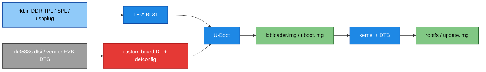

# $\color{#00c853}{\text{RK3588 Compute Module — custom board နဲ့ SDK အတွက် Rockchip အချက်အလက်}}$

ဒီဖိုင်က `./99_Rockchip_VendingMaching/README.md` ဖြစ်ပါတယ်။ ရည်ရွယ်ချက်က RK3588 Compute Module သုံးတဲ့ ကိုယ်ပိုင် breakout board ကို customize လုပ်ပြီး SDK ထုတ်ဖို့ပါ။ လက်ရှိ ရထားတာက Rock 5B အတွက် vendor image တွေပဲ ဖြစ်တယ် — ဒါတွေက board-level artifact တွေမို့ custom board အတွက် တိုက်ရိုက် အသုံးပြုလို့ မရပါဘူး[8][11]။

`./TODO.md` ထဲက "Vendor Upstream" နဲ့ "Compute Chip Only Upstream" ဆိုတဲ့ မေးခွန်းနှစ်ခုကို ဒီစာတမ်းမှာ ခွဲဖြေထားပါတယ်။ အောက်ပါအချက်အလက်အားလုံးကို 2026-11-21 မှာ primary source တွေကနေ ဖတ်ပြီး အတည်ပြုထားတာပါ။ Hardware ပေါ်မှာ စမ်းထားတာ မဟုတ်ပါဘူး။

## $\color{red}{\text{Board image နဲ့ chip BSP ကွဲပြားချက်}}$

| အမျိုးအစား | ပါဝင်တာ | ရရှိရာ |
|---|---|---|
| Board image | ပြင်ဆင်ပြီး loader, device tree, defconfig, distro userspace | Radxa[8], Armbian[11] |
| Chip BSP | kernel, U-Boot, rkbin, MPP စတဲ့ source တွေ | rockchip-linux[1] |
| Mainline | upstream Linux / U-Boot, board-agnostic | Collabora status[20] |
| SDK | repo manifest, build scripts, docs, toolchain | Khadas guide[5] |

Custom board အတွက် လိုအပ်တာက chip BSP + ကိုယ့်ဘုတ်ရဲ့ DT/defconfig ဖြစ်ပြီး board image ကို ပြန်ဖြည်တာ မဟုတ်ပါဘူး။

## $\color{red}{\text{၁။ Vendor Upstream — repo အခြေအနေ}}$

`https://github.com/rockchip-linux` မှာ public repo ၁၁ ခု ရှိပါတယ် — `kernel`, `u-boot`, `rkbin`, `mpp`, `rkdeveloptool`, `rknpu`, `rknpu2`, `rknn-toolkit`, `rknn-toolkit2`, `RKNPUTools` စတာတွေ ပါတယ်[1]။

Branch တွေက chip အလိုက် မဟုတ်ဘဲ kernel version အလိုက်ပါ[2][3]:
- kernel: `develop-6.1` (default), `develop-5.10`, `develop-6.12`
- U-Boot: `next-dev` (default), `v5`
- rkbin: `master`, mpp: `develop`

`airockchip` က organization မဟုတ်ဘဲ AI-focused personal account ဖြစ်ပါတယ် — `rknn-toolkit2`, `rknn_model_zoo`, `librga` စတာတွေပဲ ရှိပြီး kernel/u-boot/rkbin မရှိပါဘူး[4]။

အရေးကြီးတာ: အဟောင်း SDK docs တွေမှာ ပါတဲ့ `rockchip-linux/buildroot`, `rockchip-linux/manifests`, `rockchip-linux/rk-rootfs-build`, `rockchip-linux/rktools`, `rockchip-linux/rga`, `rockchip-linux/meta-rockchip` တို့ကို တိုက်ရိုက် ဖွင့်ကြည့်ရင် HTTP 404 ပြန်နေပါပြီ။ ဒါကြောင့် SDK manifest အတွက် Radxa ရဲ့ `manifests`/`build` ကို အားကိုးရပါမယ်[9][10]။

## $\color{red}{\text{၂။ Vendor SDK ပါဝင်ပစ္စည်းနဲ့ docs}}$

Khadas Edge2 ရဲ့ RK3588 Linux SDK လမ်းညွှန်အရ Buildroot, Debian နဲ့ Yocto ကို ပံ့ပိုးပါတယ်။ `repo sync` ပြီးရင် `app, buildroot, debian, device/rockchip, docs, external, kernel, output, prebuilts, rkbin, rkflash.sh, tools, u-boot, yocto` တွေ ရပါတယ် — `device/rockchip` က board config + build/packaging, `docs` က chip/Linux docs, `prebuilts` က cross toolchain, host အတွက် Ubuntu 22.04 အကြံပြုထားပါတယ်[5]။

တရားဝင် docs က SDK ထဲက `docs/{cn,en}/` ထဲမှာ ရှိပြီး canonical public URL မရှိပါဘူး။ အများပြည်သူ mirror အဖြစ် `axlrose/rkdocs` (2022 က နောက်ဆုံး update) မှာ `Rockchip_Developer_Guide_Linux_Software_CN.pdf` တွေ ရှိပါတယ်[6]။

Yocto ကိုသုံးမယ်ဆိုရင် `JeffyCN/meta-rockchip` (branch `wrynose`) က Rockchip engineer ပြုပြင်ထားတဲ့ community layer ဖြစ်ပြီး kernel/u-boot/rkbin ကို နားလည်တဲ့ directory ကနေ `file://` + `AUTOREV` နဲ့ ယူပါတယ်[7]။ တရားဝင် layer ကတော့ Yocto Project မှာ ရှိပါတယ်[31]။

### $\color{cyan}{\text{Software stack ရွေးချယ်မှု}}$

- Buildroot — SDK ထဲမှာ ပါတာမို့ အသေးဆုံး လမ်းကြောင်း[5]
- Yocto/meta-rockchip — machine config ထည့်ပြီး DTB, firmware, kernel config တွေ စီမံချင်ရင်[7][31]
- Debian/Ubuntu rootfs — Rock 5B image တွေမှာ အဆင်သင့်ပါပြီ[8][11]

## $\color{red}{\text{၃။ Boot chain}}$

`rkbin` ထဲမှာ SPL / DDR / UsbPlug / BL31 / BL32 / OP-TEE binary တွေ ရှိပြီး filename က `[platform]_[component]_[feature]_[version]` စနစ်ဖြစ်ပါတယ်[14]။ RK3588 အတွက် တကယ့် blob တွေက `rk3588_ddr_lp4_2112MHz_lp5_2400MHz_v1.24.bin`, `rk3588_spl_v1.14.bin`, `rk3588_bl31_v1.56.elf`, `rk3588_usbplug_v1.11.bin` စတာတွေ ဖြစ်ပါတယ်[15]။

Mainline U-Boot ကလည်း RK3588 အတွက် `BL31` နဲ့ `ROCKCHIP_TPL` ကို rkbin ကနေ ယူခိုင်းပြီး `make evb-rk3588_defconfig` ကို အသုံးပြုပါတယ်[16][22]။ DDR blob ကို `ddrbin_tool.py` နဲ့ baud/iomux ပြင်လို့ရပြီး TF-A ကိုတော့ `make PLAT=rk3588 bl31` နဲ့ ကိုယ်တိုင် build လို့ရပါတယ်[23]။

Flash လုပ်ရင် `dd if=u-boot-rockchip.bin of=/dev/sdX seek=64` သို့မဟုတ် `rkdeveloptool wl 64 u-boot-rockchip.bin` ကို သုံးပါတယ်[22][23]။ MaskRom/rockusb အသေးစိတ်ကို `opensource.rock-chips.com/wiki_Rockusb` ကနေ ဖတ်လို့ မရခဲ့ပါဘူး — ဒါကြောင့် အဲဒီအပိုင်းက အတည်မပြုရသေးပါဘူး[17]။

## $\color{red}{\text{၄။ Device tree workflow}}$

Vendor kernel ရဲ့ `arch/arm64/boot/dts/rockchip` ထဲမှာ baseline အဖြစ် `rk3588s.dtsi`, `rk3588-linux.dtsi`, `rk3588-amp.dtsi`, `rk3588-android.dtsi` နဲ့ EVB board file တွေ ရှိပါတယ်[18]။ EVB override ပုံစံကို `rk3588-evb1-lp4-v10-linux.dts` မှာ `&route_hdmi0 { status = "okay"; ... /delete-property/ force-output; }` လို့ ရေးထားတာ တွေ့ရပါတယ်[19]။

ကိုယ့်ဘုတ်အတွက် ပြင်ရမယ့်အရာ: DDR size/type, PMIC (ဥပမာ rk806), UART iomux, eMMC/SD, PHY နဲ့ connector node တွေ ဖြစ်ပါတယ်[7][18][20]။ module ရဲ့ schematic နဲ့ တိုက်ဆိုင်စစ်ရပါမယ်။

## $\color{red}{\text{၅။ Compute Chip Only နဲ့ mainline upstream}}$

Collabora ရဲ့ RK3588 mainline status ဇယားအရ pinmux 5.19-rc1, GPIO/UART/eMMC/I2C 6.0-rc1, Ethernet 6.1-rc1, PCIe 2/3 6.7-rc1, USB3 host 6.8-rc1, GPU 6.10-rc1, HDMI 6.13-rc1, NPU 6.18-rc1 တွေ စတင်ပါတယ်[20]။ ISP က PATCHv3 ပို့ထားဆဲ, VEPU580 H.264/H.265 encode က WIP, DP AltMode လည်း WIP ဖြစ်နေဆဲပါ[20]။

၂၀၂၂ ဧပြီက ပထမဆုံး "Basic RK3588 Support" patch မှာ debug UART တစ်ခုတည်းနဲ့ eMMC ကနေ Debian boot လုပ်နိုင်ပေမယ့် "apart from that nothing works" လို့ ဖော်ပြထားပါတယ်[21]။ `rockchip,rk3588` compatible string ကို primary source မှာ တိုက်ရိုက် အတည်မပြုနိုင်ခဲ့ပါဘူး — defconfig ထဲမှာ `CONFIG_ROCKCHIP_RK3588=y` ဆိုတာပဲ တွေ့ရပါတယ် (search-only)[37]။

Mainline GPU driver က Panthor ဖြစ်ပါတယ်[30]။ Mainline NPU (`drivers/accel/rocket`) 6.18 မှာ ပါတယ်ဆိုတာ ဒုတိယအဆင့် source တွေက ပြောတာဖြစ်ပြီး vendor RKNN နဲ့ မတူတဲ့ stack မို့ `.rknn`/RKLLM model တွေကို မမောင်းနိုင်ပါဘူး (search-only, အတည်မပြုရသေး)[35][36]။

"Mainline မှာ အလုပ်လုပ်တယ်" ဆိုတာ "feature ပြည့်တယ်" မဟုတ်ပါဘူး — camera/ISP, H.265 encode နဲ့ NPU workload အပြည့်အစုံအတွက် patch သို့မဟုတ် vendor component လိုနေဆဲပါ[20]။

## $\color{red}{\text{၆။ NPU နဲ့ multimedia stack}}$

`airockchip/rknpu2` က 2023-12-13 မှာ archive လုပ်ထားပြီး `rknn-toolkit2` ထဲက `rknpu2` ကို ရွှေ့သွားတာပါ[24]။ Toolkit2 မှာ PC-side conversion/quantization, board ပေါ်က Lite2 Python API, C/C++ Runtime တွေ ပါပြီး RK3588 ကို ပံ့ပိုးပါတယ် — latest v2.5.0, Python 3.6–3.12, v1 toolkit နဲ့ မကိုက်ညီပါဘူး[25]။

Version ကိုက်ညီမှုက အရေးကြီးပါတယ် — `rknn_model_zoo` 2.5.0 က RKNPU2 SDK ≥2.5.0 လိုအပ်ပြီး[26], `rknn_server`, `librknnrt.so`, RKNN-Toolkit2 version တွေ တူရပါမယ်။ Dynamic-input model ဆိုရင် server/runtime ≥1.5.0 လိုအပ်ပါတယ်[27]။

Video အတွက် `rockchip-linux/mpp` က hardware decode/encode userspace ဖြစ်ပြီး kernel-side video driver လိုပါတယ်[28]။

2D accel အတွက် `airockchip/librga` (v1.10.6) ရှိပြီး multi_rga driver ≥1.2.4 (≥1.3.13 အကြံပြု) လိုအပ်ပါတယ်[29]။

Camera RKISP pipeline နဲ့ MPP kernel ioctl ကတော့ အဓိကအားဖြင့် BSP/out-of-tree ပဲ ဖြစ်နေဆဲပါ[20][28]။

## $\color{red}{\text{၇။ Custom board အတွက် လက်တွေ့အဆင့်များ}}$

1. တည်ငြိမ်တဲ့ commit/sha တွေ ချိတ်ပါ — `kernel@develop-5.10` သို့မဟုတ် `develop-6.1`, `u-boot@next-dev`, `rkbin@master`[2][3][14]။
2. Board vendor tree (`radxa/manifests`, `radxa/build`) ကနေ `device/rockchip` layout ကို လေ့လာပြီး ကိုယ့် module ရဲ့ DT/defconfig နဲ့ အစားထိုးပါ[9][10]။
3. `rk3588s.dtsi` + နီးစပ်ရာ EVB DTS ကနေ စပြီး PMIC, DDR, UART, boot media, PHY, connector တွေ ပြင်ပါ[18][19]။
4. Boot chain ကို ဆောက်ပါ — DDR TPL (သင့် UART/iomux အတိုင်း patch) → TF-A `PLAT=rk3588` → U-Boot defconfig → `idbloader.img`/`uboot.img` → kernel+DTB → rootfs → `update.img`[14][16][23]။
5. SDK အတွက် Buildroot (အသေးဆုံး) သို့မဟုတ် meta-rockchip machine config ရွေးပြီး U-Boot config, kernel config, DTB, firmware ထည့်ပါ[5][7][31]။
6. NPU/multimedia stack ကို ရည်ရွယ်ချက်အလိုက် ရွေးပါ — mainline V4L2/Panthor/RGA2 သို့မဟုတ် vendor MPP/RGA/librknnrt[20][25][28]။
   Toolkit2 ↔ librknnrt ↔ server version တူအောင် ထားပါ[27]။
7. Flash အတွက် `dd seek=64` / `rkdeveloptool wl 64` ကို သုံးပြီး MaskRom က recovery အဖြစ် ထားပါ[22][23]။

## $\color{red}{\text{၈။ မသိသေးတာနဲ့ စစ်ရမယ့်အချက်များ}}$

- မင်းရဲ့ module ရဲ့ DDR size/type, PMIC (rk806 လား/အခြားလား), eMMC, UART iomux ကို မပေးထားသေးပါဘူး — module vendor ရဲ့ DTS/schematic နဲ့ တိုက်ဆိုင်စစ်ရပါမယ်။
- DDR init blob, SPL, UsbPlug, BL31/BL32/OP-TEE တွေက public မှာ binary အဖြစ်ပဲ ရပါတယ် — DDR configuration ရဲ့ source မရှိပါဘူး[14][15]။ ဘုတ်အသစ်အတွက် vendor support လိုနိုင်ပါတယ်[16]။
- တချို့ ISP/camera နဲ့ DDR tuning docs က NDA အောက်မှာ ရှိနိုင်ပါတယ်[6]။
- License တွေ ကွဲပြားပါတယ် — kernel GPL, rkdeveloptool GPL-2.0, MPP Apache/MIT, RKNN BSD-3, rkbin binary တွေရဲ့ license မရှင်းလင်းပါဘူး[1][28][25]။ ပို့ခင် audit လုပ်ပါ။
- Collabora ဇယားက နေ့စဉ်ပြောင်းနေတာမို့ kernel tag ကို ချိတ်ထားပါ[20]။
- ဒီစာတမ်းမှာ hardware test, build, version-matrix validation ဘာမှ မလုပ်ထားပါဘူး။ search-only လို့ တံဆိပ်တပ်ထားတဲ့ source တွေက ရှာဖွေရလဒ်ကနေပဲ ယူထားတာဖြစ်ပါတယ်။

Sources:
[1] https://github.com/rockchip-linux
[2] https://github.com/rockchip-linux/kernel/branches
[3] https://github.com/rockchip-linux/u-boot/branches
[4] https://github.com/airockchip
[5] https://docs.khadas.com/products/sbc/common/development/edges-rockchip-linux-sdk
[6] https://github.com/axlrose/rkdocs
[7] https://github.com/JeffyCN/meta-rockchip/blob/master/README.md
[8] https://docs.radxa.com/en/rock5/rock5b/download
[9] https://github.com/radxa/manifests
[10] https://github.com/radxa/build
[11] https://armbian.com/boards/rock-5b
[14] https://github.com/rockchip-linux/rkbin/blob/master/README.md
[15] https://github.com/rockchip-linux/rkbin/tree/master/bin/rk35
[16] https://docs.u-boot-project.org/en/v2023.07.02/board/rockchip/rockchip.html
[17] https://opensource.rock-chips.com/wiki_Rockusb
[18] https://github.com/rockchip-linux/kernel/tree/develop-5.10/arch/arm64/boot/dts/rockchip
[19] https://github.com/rockchip-linux/kernel/blob/develop-5.10/arch/arm64/boot/dts/rockchip/rk3588-evb1-lp4-v10-linux.dts
[20] https://gitlab.collabora.com/hardware-enablement/rockchip-3588/notes-for-rockchip-3588/-/raw/main/mainline-status.md
[21] https://lore.kernel.org/lkml/20220422170920.401914-1-sebastian.reichel@collabora.com/T
[22] https://docs.u-boot-project.org/en/latest/board/rockchip/rockchip.html
[23] https://docs.u-boot-project.org/en/latest/board/theobroma-systems/tiger_rk3588.html
[24] https://github.com/airockchip/rknpu2
[25] https://github.com/airockchip/rknn-toolkit2
[26] https://github.com/airockchip/rknn_model_zoo
[27] https://raw.githubusercontent.com/airockchip/rknn-toolkit2/master/doc/EN/01_RKNN2_SDK_QuickStart_V2.5.0.pdf
[28] https://github.com/rockchip-linux/mpp
[29] https://github.com/airockchip/librga
[30] https://docs.kernel.org/gpu/panthor.html
[31] https://git.yoctoproject.org/meta-rockchip
[35] https://www.phoronix.com/news/DRM-Misc-Next-Linux-6.18
[36] https://www.techveda.live/2026/08/19/mainline-npu-driver-rk3588
[37] https://github.com/u-boot/u-boot/blob/main/configs/orangepi-5-rk3588s_defconfig

References:
- `./99_Rockchip_VendingMaching/README.md`
- `./AGENTS.md`
- `./AGENTS_for_markdown.md`
- `./TODO.md`
- `./01_Rock5B_Debian/README/00_HOW_TO_BUILD_LINUX_SDK.md`
- `./md_lists.md`
